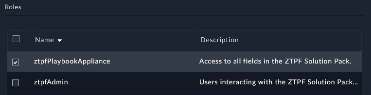
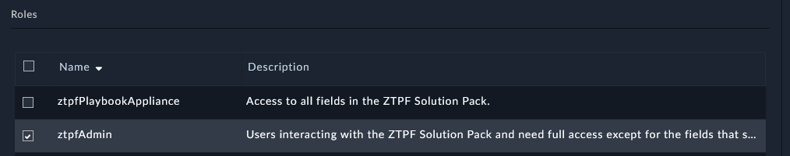

| [Home](../README.md) |
|--------------------------------------------|

# Configuration

## Roles

Two roles ship with the solution pack:

| Role | Applied To | Purpose |
| ---- | ---------- | ------- |
| `ztpfPlaybookAppliance` | The Playbook Appliance user under `Settings > Access Keys > Appliances` | Open and edit the playbook appliance user roles to update the fields owned by the framework and FortiManager. |
| `ztpfAdmin` | The users who operate the framework | Users should not directly edit fields that are owned by FortiManager. |

Assign the `ztpfPlaybookAppliance` role to the Playbook Appliance user:

Assign the `ztpfAdmin` role to the users who will use the solution:

## Connectors

- Install the `Code Snippet` connector and make sure it has a configuration marked as `Mark as default configuration`. The framework uses it for data shaping, diffs, and YAML conversion.

The FortiManager JSON-RPC connector configuration does not need manual setup — it is created from the Manager record. See [Add a Manager](./setup.md#add-a-manager).

## Next Steps

| [<](./setup.md) | [Usage](./usage.md) | [Contents](./contents.md) |
|-----------------|---------------------|---------------------------|
