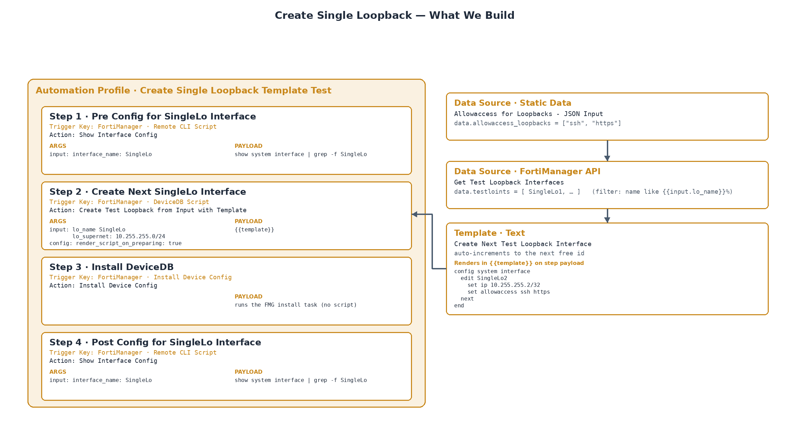

| [Home](../../README.md) / [Usage](../usage.md) / Examples |
|-------------------------------------------------------------|

# Example: Create Single Loopback — Building an Automation Profile

This worked example — the records are tagged `SingleLo` — builds an automation profile that creates the next test loopback interface on a FortiGate through FortiManager, installs it to the device, and confirms the result on the device. It walks through every building block of the framework in order: **Data Sources → Template → Automation Actions → Automation Profile with Steps → Run**.

Prerequisite: work through checklist steps 1 and 2 of the [Usage](../usage.md) guide first — a connected Manager and at least one device you can experiment on (real or model).

## What You Will Build

| Module | Record | Purpose |
| ------ | ------ | ------- |
| [Data Sources](../modules/data_sources.md) | Allowaccess for Loopbacks - JSON Input | Static Data providing `data.allowaccess_loopbacks` |
| [Data Sources](../modules/data_sources.md) | Get Test Loopback Interfaces | FortiManager API query providing `data.testloints` |
| [Templates](../modules/templates.md) | Create Next Test Loopback Interface | Jinja script that renders the CLI config and auto-increments the loopback ID |
| [Automation Actions](../modules/automation_actions.md) | Create Test Loopback from Input with Template | DeviceDB Script that runs the rendered config |
| [Automation Actions](../modules/automation_actions.md) | Show Interface Config | Remote CLI Script that shows the interface config before and after |
| [Automation Actions](../modules/automation_actions.md) | Install Device Config | Installs the DeviceDB changes to the device |
| [Automation Profiles](../modules/automation_profiles.md) | Create Single Loopback Template Test | Orders the four steps and runs them per device |



*The build at a glance: the profile orders the four steps; the two Data Sources and the Template feed Step 2's action, and the run renders, installs, and confirms the next test loopback.*

## Step 1 — Create the Data Sources

The profile needs two pieces of data at run time: the list of services allowed on the new loopback, and the loopback interfaces that already exist on the device (to auto-increment the ID).

### 1.1 Static Data — `Allowaccess for Loopbacks - JSON Input`

Create a record in the [Data Sources](../modules/data_sources.md) module:

| Field | Value |
| ----- | ----- |
| Name | `Allowaccess for Loopbacks - JSON Input` |
| Type | Static Data |
| Data Key | `allowaccess_loopbacks` |

Script payload:

```json
[
  "ssh",
  "https"
]
```

The rendered result is stored whole under the Data Key, so any script rendering for this device can read `data.allowaccess_loopbacks`.

### 1.2 FortiManager API — `Get Test Loopback Interfaces`

Create a second Data Source record:

| Field | Value |
| ----- | ----- |
| Name | `Get Test Loopback Interfaces` |
| Type | FortiManager API |
| Data Key | `testloints` |
| Input Parameters | `lo_name` |

Script payload:

```json
{
  "url": "/pm/config/device/{{record.device.name}}/global/system/interface",
  "fields": ["name", "ip"],
  "filter": [["type", "==", "loopback"], "&&", ["name", "like", "{{input.lo_name}}%"]],
  "loadsub": 0
}
```

Two things to note: Jinja is rendered in the URL (`record.device.name`) and in the filter (`input.lo_name` — the steps pass `SingleLo` as the input, so the query matches `SingleLo%`).

Use the test wizard on each record — `Get Metadata Source Data on Device` — to confirm both sources return the data you expect for a selected device before moving on.

## Step 2 — Create the Template

Create a record in the [Templates](../modules/templates.md) module:

| Field | Value |
| ----- | ----- |
| Name | `Create Next Test Loopback Interface` |
| Output Type | Text |
| Input Parameters | `lo_name` and `lo_supernet` (one per line) |
| Data Sources | link `Allowaccess for Loopbacks - JSON Input` and `Get Test Loopback Interfaces` |

Script payload:

```jinja



  
  
    
  


config system interface
  edit {{input.lo_name}}{{max.id+1}}
    set vdom root
    set type loopback
    
    set ip {{net | ipaddr(max.id+1) | ipaddr('address') }}/32
    
    set allowaccess {{data.allowaccess_loopbacks|join(" ")}}
    set description "Test Looopback {{input.lo_name}} for {{record.device.name}}."
  next
end
```

What the script does:

- Scans `data.testloints` — the existing loopbacks collected by the Data Source — for the highest numbered `SingleLo<n>` interface.
- Renders an `edit` block for the next free ID, taking the IP from the `lo_supernet` input via the `ipaddr` filter.
- Joins `data.allowaccess_loopbacks` into the `allowaccess` line.

Fill in the Example Jinja Vars and Example Output fields on the record so the render can be tested from the record itself. The export uses these example variables — `data.testloints` contains `SingleLo1`, so the next ID is 2:

```json
{
  "data": {
    "testloints": [ { "ip": ["10.255.255.1", "255.255.255.255"], "oid": 170, "name": "SingleLo1", "vdom": [] } ],
    "allowaccess_loopbacks": ["ssh", "https"]
  },
  "input": { "lo_name": "SingleLo", "lo_supernet": "10.255.255.0/24" },
  "record": { "device": { "name": "FG1", "adom": "Demo76" } }
}
```

Example output:

```
config system interface
  edit SingleLo2
    set vdom root
    set type loopback
    set ip 10.255.255.2/32
    set allowaccess ssh https
    set description "Test Looopback SingleLo for FG1."
  next
end
```

## Step 3 — Create the Automation Actions

Each [Automation Action](../modules/automation_actions.md) wraps a payload with the mechanics of running it, plus the output templates and the status template that decide whether the step worked.

### 3.1 DeviceDB Script action — `Create Test Loopback from Input with Template`

| Field | Value |
| ----- | ----- |
| Category | FortiManager |
| Type | DeviceDB Script |
| Script | `{{template}}` |
| Template | link `Create Next Test Loopback Interface` |

The script is only `{{template}}` — the whole payload is authored in the linked Template and rendered there, with `input.*` supplied by the step arguments.

Output Template (Text):

```
{{ output.log.content }}
```

Output Template (Markdown):

````jinja
### {{ record.device.name }} — Loopback Creation Result

| Field | Value |
|---|---|
| Task ID | {{ output.task.task_id }} |
| Status | {{ output.task.msg }} |
| Executed | {{ output.log.exec_time }} |
| Script name | `{{ output.log.script_name }}` |

```
{{ output.log.content }}
```
````

Output Status Template:

```jinja

exception: true
message: "Script may have failed on {{ record.device.name }} (Task {{ output.task.task_id }}): {{ output.log.content | trim }}"

exception: false
message: "Script completed successfully on {{ record.device.name }} (Task {{ output.task.task_id }}): {{ output.task.msg }}"

```

The status template is what turns raw output into a step result: `exception: true` flags the step as failed and stops the run unless the step is configured to continue with an exception.

### 3.2 Remote CLI Script action — `Show Interface Config`

| Field | Value |
| ----- | ----- |
| Category | FortiManager |
| Type | Remote CLI Script |
| Input Parameters | `interface_name` |
| Script | below |

```jinja
show system interface | grep -f {{input.interface_name}}
```

Output Template (Text): `{{ output.log.content }}`

Output Template (Markdown):

````jinja
Script results for **{{record.device.name}}** from **Task ID {{output.log.log_id}}**:

```
{{output.log.content}}
```
````

Output Status Template — the simple case:

```jinja
exception: false
message: No exceptions found.
```

### 3.3 Install Device Config action — `Install Device Config`

| Field | Value |
| ----- | ----- |
| Category | FortiManager |
| Type | Install Device Config |
| Script | `{{template}}` (no Template linked — this action drives the install itself) |

This action takes no inputs and no template: it installs the DeviceDB changes created by earlier steps in the run.

Output Template (Text): `{{ output.task.msg }}`

Output Template (Markdown):

```jinja
### Task Summary
- **Task ID:** {{ output.task.task_id }}
- **Status:** {{ output.task.task_data.state }}
- **Total Time:** {{ output.task.task_time.total_time }}
- **Errors:** {{ output.task.task_data.num_err }} | **Warnings:** {{ output.task.task_data.num_warn }}

### Install History
| Line | Detail | Percent |
|---|---|---|
| {{ line.name }} | {{ h.detail }} | {{ h.percent }}% |


### Result
`{{ output.task.msg }}`
```

Output Status Template — checking the install task for errors, warnings, and failed lines:

```jinja




exception: true
message: FortiManager reported an error for task {{ output.task.task_id }}: {{ output.task.msg }}

exception: true
message: "{{ err_count }} line(s) reported errors on task {{ output.task.task_id }}: {{ failed_lines | map(attribute='detail') | join('; ') }}"

exception: true
message: "{{ warn_count }} warning(s) on task {{ output.task.task_id }} for {{ record.device.name }}: {{ output.task.msg }}"

exception: false
message: No exceptions found. Task {{ output.task.task_id }} completed OK for {{ record.device.name }}.

```

### 3.4 Remote CLI Script action — `Delete Test Loopbacks from Input with Template`

The same pattern as 3.1, but for cleanup: Type `Remote CLI Script`, script `{{template}}`, linked to a `Delete Test Loopback Interfaces` template that loops over `data.testloints` and deletes every matching interface. It is used by the cleanup profile shown at the end of this example.

## Step 4 — Create the Automation Profile and Add the Steps

Create a record in the [Automation Profiles](../modules/automation_profiles.md) module:

| Field | Value |
| ----- | ----- |
| Name | `Create Single Loopback Template Test` |
| Description | 1. Create an interface `SingleLo` via the DeviceDB · 2. Install the Config to the remote device · 3. Confirm the Config in the FG via the Remote CLI |

Then add four steps with `Add Step`, in this order:

| Seq | Step Name | Action | Step Args |
| --- | --------- | ------ | --------- |
| 1 | Pre Config for SingleLo Interface | Show Interface Config | `input: interface_name: SingleLo` |
| 2 | Create Next SingleLo Interface | Create Test Loopback from Input with Template | see below |
| 3 | Install DeviceDB | Install Device Config | — |
| 4 | Post Config for SingleLo Interface | Show Interface Config | `input: interface_name: SingleLo` |

Step arguments are stored on the step as YAML with an `input` section and an optional `config` section. Step 2 (`Create Next SingleLo Interface`) supplies the template's two inputs and a config option:

```yaml
input:
  lo_name: SingleLo
  lo_supernet: 10.255.255.0/24
config:
  render_script_on_preparing: true
```

The `input` section becomes `input.lo_name` and `input.lo_supernet` inside the template — the same values the Data Source filter and the script use. The `config` section tunes step behavior: `render_script_on_preparing` renders the final payload when the step is prepared instead of when it runs.

Steps 1 and 4 run the same action with the same arguments — before and after — so their outputs show the interface config before the change and after the install.

## Step 5 — Run It and Verify

Run the profile on a device. The framework creates a [Run Group](../modules/run_groups.md) and materializes one [Device Automation Step](../modules/device_automation_steps.md) per profile step, each holding the final payload it ran and the output produced.

What to check, step by step:

1. **Pre Config** — the CLI output shows no `SingleLo` interface yet.
2. **Create Next SingleLo Interface** — the DeviceDB script ran the rendered `config system interface` payload; the status template reports success with the task ID.
3. **Install DeviceDB** — the install task summary shows the line history completing with no errors.
4. **Post Config** — the CLI output now shows `SingleLo1` with its address and allowaccess settings.

## Variants Included in the Export

Two companion profiles round out the example:

- **`Create Single Loopback Template Test x2`** — runs the create step twice in one run. The second create step sets `render_script_on_preparing: false`, so its payload renders at run time — after the first create step completed — and the auto-increment logic sees the interface the first step just made, producing `SingleLo1` then `SingleLo2`. This is the clean demonstration of why render timing matters when a step depends on data changed by an earlier step.
- **`Delete Single Loopback Template Test`** — the cleanup pattern: `Delete SingleLo Interfaces` (delete template via Remote CLI), `Install Device Config`, then `Confirm Loopback Interfaces are Deleted` (Show Interface Config again).

## Takeaways

- Data Sources feed `data.<datakey>` — static values and live FortiManager queries alike.
- Templates hold the reusable payload and declare the inputs they need; data sources link to the template.
- Actions wrap the payload with Category/Type mechanics, output formats, and the status template that decides pass or exception.
- Step arguments carry `input:` values into the action/template and `config:` options into the step.
- The profile is just the ordered list of steps; the run lives in Run Groups and Device Automation Steps.
- Render timing (`render_script_on_preparing`) matters when a step depends on data changed by an earlier step.

See also: [Data Sources](../modules/data_sources.md) · [Templates](../modules/templates.md) · [Automation Actions](../modules/automation_actions.md) · [Automation Profile Steps](../modules/automation_profile_steps.md) · [Run Groups](../modules/run_groups.md)
