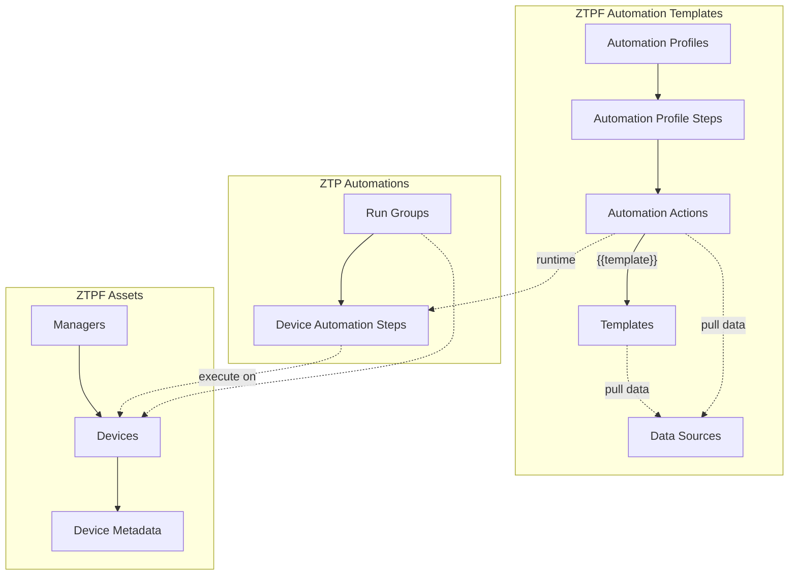

| [Home](../README.md) |
|--------------------------------------------|

# Modules

The ZTPF Framework is built from a set of modules that work together to provision and operate FortiGate devices through one or more FortiManagers. The modules are grouped into three areas: the design-time records that define your automation, the asset records that represent your deployment, and the runtime records that execute that automation. Each module below links to a detail page with the full list of fields and how they are used.

## ZTPF Automation Templates

These modules define what automation is available and how it is built. Automation Profiles and Automation Profile Steps assemble the work, Automation Actions and Templates produce the payloads, and Data Sources gather the data used while rendering.

### [Automation Profiles](./modules/automation_profiles.md)

Automation Profiles define a named, ordered automation recipe — such as onboarding, a lifecycle change, or a firmware upgrade — that can be assigned to devices. Each profile is a container for its ordered [Automation Profile Steps](./modules/automation_profile_steps.md).

### [Automation Profile Steps](./modules/automation_profile_steps.md)

Automation Profile Steps are the individual steps of an Automation Profile. Each step is ordered by step number and bound to an [Automation Action](./modules/automation_actions.md), with Step ARGS supplying YAML input and config values for the step.

### [Automation Actions](./modules/automation_actions.md)

Automation Actions are reusable definitions of the work a step performs. The action Category and Type select the playbook that executes a step, the Jinja script builds the action payload — often by rendering a linked [Template](./modules/templates.md) — and output templates shape the results reported back to the step record.

### [Templates](./modules/templates.md)

Templates are reusable Jinja scripts that produce a payload in a declared output type, such as Text, JSON, Markdown, or HTML. When linked to an Automation Action, the rendered template is available in the action script as the `{{template}}` variable, and required runtime data is gathered by [Data Sources](./modules/data_sources.md).

### [Data Sources](./modules/data_sources.md)

Data Sources collect and shape runtime data used to render [Automation Actions](./modules/automation_actions.md) payloads and their linked Templates. A source can gather static values, FortiManager API data, Proxy API data from a FortiGate, playbook results, or the output of earlier steps, and its results are merged into the Jinja context as `data.<datakey>`. Data Sources are runtime data collectors and are not the same as Device Metadata, the persistent per-device values stored with each device record.

## ZTPF Assets

These modules represent your FortiManager deployment: the managers, their devices, and the per-device metadata used by automation.

### [Managers](./modules/managers.md)

Manager records define the FortiManagers used in your solution. Creating a Manager with a host, RPC user, and password automatically creates its FortiManager JSON-RPC connector configuration, synchronizes system details from the API, and controls how new [Devices](./modules/devices.md) are discovered.

### [Devices](./modules/devices.md)

Device records are synchronized from the FortiManager Device DB and are the target of all ZTPF automation. Devices retain their last known state even if they are removed from the [Manager](./modules/managers.md), so reporting and automation history remain available.

### [Device Metadata](./modules/device_metadata.md)

Device Metadata records store persistent key/value data per device as Text, JSON, or Secret values. Metadata is exposed to Jinja as `record.metadata.<name>`, can be synchronized to FortiManager variables, and belongs to its [Device](./modules/devices.md).

## ZTP Automations

These modules are the runtime records created when automation is queued and executed on devices.

### [Run Groups](./modules/run_groups.md)

Run Groups batch the pending [Device Automation Steps](./modules/device_automation_steps.md) of one or more devices into a single named execution, tracking totals, running time, and overall status as steps complete.

### [Device Automation Steps](./modules/device_automation_steps.md)

Device Automation Steps are the runtime queue of automation: one record per step per device, materialized from Automation Profile Steps when a run starts. Steps move through a status lifecycle of New, Preparing, Ready, Queued, Running, and Complete or Fail, render their scripts with device data, and execute the [Automation Action](./modules/automation_actions.md) assigned to them. Each step stores its raw output along with rendered text, markdown, HTML, and JSON results, and an evaluated output status.

| [Installation](./setup.md#installation) | [Usage](./usage.md) | [Contents](./contents.md) |
|-----------------------------------------|---------------------|----------------------------|
