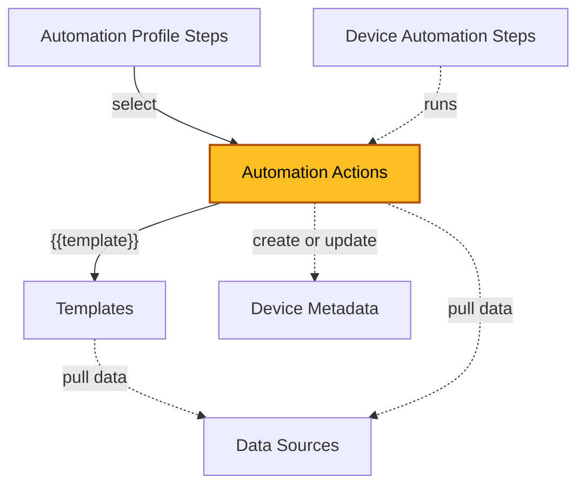

| [Home](../../README.md) / [Modules](../modules.md) |
|-----------------------------------------------------|

# Automation Actions

Record module: `ztpf_automation_actions`

*The highlighted box marks the module documented on this page.*

## Summary

Automation Actions are reusable definitions of the work an automation step performs. A [Automation Profile Step](./automation_profile_steps.md) selects an action, and at run time the action's Category and Type become the step's Trigger Key — for example `FortiManager Remote CLI` — which dispatches the step to the playbook that performs the work.

The action is where an author defines everything about the work:

 * **The script payload** — a Jinja script, often rendering a linked [Template](./templates.md) as the `{{template}}` variable, with data supplied by linked [Data Sources](./data_sources.md) as `data.<datakey>`.
 * **The contract with steps** — Input Parameters declare the fields a step must provide as `input.<fieldname>`, and Config Parameters declare settings that steps fill in.
 * **The results** — output templates render the step's Text, Markdown, HTML, and JSON output; the Output Status Template evaluates the output for exceptions; and the Output to Metadata Record Template can create or update [Device Metadata](./device_metadata.md) records from the results.

Actions are never executed directly. They are referenced by profile steps at design time and run by [Device Automation Steps](./device_automation_steps.md) at run time.

## Category and Type

Every action has a Category and a Type. The Category groups the kind of work: FortiManager actions perform work through the FortiManager API, ZTPF actions operate on step output and run flow such as diffs, validation, and waits, and FortiSOAR actions run inside FortiSOAR, such as calling a playbook. The Type identifies the specific work, and together the Category and Type form the step's Trigger Key — for example `FortiManager Remote CLI` — that dispatches the step to its playbook.

| Category | Type | Script Payload | Description |
| -------- | ---- | -------------- | ----------- |
| FortiManager | [DeviceDB Script](./automation_actions/fortimanager/devicedb_script.md) | Jinja-rendered CLI commands. | Runs a Jinja-rendered CLI script on the device Device DB through the Manager. |
| FortiManager | [PolicyDB Script](./automation_actions/fortimanager/policydb_script.md) | Jinja-rendered CLI commands. | Runs a Jinja-rendered CLI script on the device Policy DB through the Manager. |
| FortiManager | [Remote CLI Script](./automation_actions/fortimanager/remote_cli_script.md) | Jinja-rendered CLI commands. | Runs a CLI script on the device through the Manager. |
| FortiManager | [Remote TCL Script](./automation_actions/fortimanager/remote_tcl_script.md) | Jinja-rendered TCL commands. | Runs a TCL script on the device through the Manager. |
| FortiManager | [Provisioning CLI Teamplate](./automation_actions/fortimanager/provisioning_cli_teamplate.md) | \<pending example\> | Creates a Provisioning CLI template in the Manager and assigns it to the device. |
| FortiManager | [Provisioning Jinja Teamplate](./automation_actions/fortimanager/provisioning_jinja_teamplate.md) | \<pending example\> | Creates a Provisioning Jinja template in the Manager; the Jinja is rendered by the Manager, not by FortiSOAR. |
| FortiManager | [Authorize Device](./automation_actions/fortimanager/authorize_device.md) | \<pending example\> | Authorizes a device in the Manager. |
| FortiManager | [Install Device Config](./automation_actions/fortimanager/install_device_config.md) | Not used — the playbook acts on the device directly. | Installs the device configuration from the Manager. |
| FortiManager | [Install Policy Package](./automation_actions/fortimanager/install_policy_package.md) | \<pending example\> | Installs a Policy Package to the device. |
| FortiManager | [Reinstall Policy Package](./automation_actions/fortimanager/reinstall_policy_package.md) | \<pending example\> | Reinstalls the assigned Policy Package. |
| FortiManager | [Refresh Device](./automation_actions/fortimanager/refresh_device.md) | \<pending example\> | Refreshes the device data in the Manager. |
| FortiManager | [Upgrade Device Firmware](./automation_actions/fortimanager/upgrade_device_firmware.md) | YAML with a `firmware:` key. | Upgrades the device firmware through the Manager. |
| ZTPF | [Collect Artifacts](./automation_actions/ztpf/collect_artifacts.md) | Freeform Jinja-rendered text. | Runs a collection or report from the step's rendered script and stores the results in the step output. |
| ZTPF | [Diff Step Output](./automation_actions/ztpf/diff_step_output.md) | YAML `step_data:` map selecting earlier steps and output paths. | Compares the output of two earlier steps in the run. |
| ZTPF | [Validate Data](./automation_actions/ztpf/validate_data.md) | YAML `step_data:` map selecting earlier steps and output paths. | Validates data from the device record and/or the output of earlier steps. |
| ZTPF | [Wait for Condition](./automation_actions/ztpf/wait_for_condition.md) | \<pending example\> | Holds the step in a Wait status, re-checking at a set interval until it can continue. |
| FortiSOAR | [Playbook](./automation_actions/fortisoar/playbook.md) | \<pending example\> | Runs a FortiSOAR playbook as the step. |

> **Note:** The `Provisioning CLI Teamplate` and `Provisioning Jinja Teamplate` values are spelled as shipped in the picklist.

Actions are dispatched by the generic `> device step (Running)` trigger: it looks up the step's Trigger Key in the `ztpf_running_triggerkey_idx` global variable — the **trigger key index** — and runs the playbook mapped for that key. Types without an index entry fail with a `No Automation Playbook defined for Trigger Key ...` message. To wire a new action type, add an entry to the trigger key index, or clone the provided `TEMPLATE to CLONE from` trigger playbook and set its Trigger Key filter to the new Category and Type.

## Fields

| Field | Type | Required | How it is used |
| ----- | ---- | -------- | -------------- |
| **Definition** | | | |
| Name | Text | Yes | Unique name of the action. |
| Category | Picklist | Yes | FortiManager, FortiSOAR, or ZTPF. Filters the Type list and forms the first half of the step Trigger Key. |
| Type | Picklist | Yes | The specific action type. Forms the second half of the Trigger Key used to dispatch the step to its playbook. Some types expect a specific script format. |
| Description | Rich Text | No | What the action performs and why. |
| **Payload** | | | |
| Template | Lookup (`ztpf_templates`) | No | When linked, the rendered template is available in the action script as the `{{template}}` variable. |
| Metadata Sources | Many-to-many (`ztpf_metadata_sources`) | No | Linked Data Sources that supply `data.<datakey>` values while rendering this action. |
| Config Parameters | Text | No | YAML settings that a step using this action must fill in. |
| Input Parameters | Text Area | No | Declares the input fields a step must provide. Usable in the script as `input.<fieldname>`. |
| Script | Text Area | No | The Jinja script that produces the action payload. Format expectations vary by Type — for example, Diff Step Output expects YAML instructions. |
| **Output** | | | |
| Output Template Text | Text Area | No | Jinja template that renders the step's Output Text field from the raw step output. |
| Output Template Markdown | Text Area | No | Jinja template that renders the step's Output Markdown field from the raw step output. |
| Output Template HTML | Text Area | No | Jinja template that renders the step's Output HTML field from the raw step output. |
| Output Template JSON | Text Area | No | Jinja template that renders the step's Output JSON field from the raw step output. |
| Output Status Template | Text Area | No | Jinja template that renders YAML — for example `exception: true` with a message — evaluated to set the step's Output Status. |
| Output to Metadata Record Template | Text Area | No | Jinja template that renders YAML to create or update Device Metadata records from the step output. |
| **Examples** | | | |
| Example Jinja Vars | Object | No | Sample jinja_vars used to produce the example render. |
| Example Script Rendered | Text Area | No | The rendered script produced from the example vars. |
| Example Run Output Source Data | Object | No | Sample raw output used to exercise the output templates. |
| **Usage** | | | |
| Automation Profile Steps | Related Records (`ztpf_automation_profile_steps`) | — | Profile steps that select this action. |
| Device Automation Steps | Related Records (`ztpf_device_automation_steps`) | — | Device steps that have run this action. |
| id, createDate, createUser, modifyDate, modifyUser | System | — | System-managed record details shown on the record's Details tab. |

## Working with Actions

 * `Script Help` — helps build the action script using its linked Data Sources.
 * `Build with Jinja Editor` — opens the Jinja editor with record data loaded to build the script.
 * `Render Jinja Script` — renders the script payload so it can be reviewed before use.
 * `Run Example Script Payload` — runs the payload to produce example output.
 * `Re-Render Example Script` — regenerates the example render.
 * `Delete Example Data` — clears the example data fields on the record.

## Related Modules

 * [Automation Profile Steps](./automation_profile_steps.md) — select this action at design time.
 * [Device Automation Steps](./device_automation_steps.md) — run this action at run time.
 * [Templates](./templates.md) — payload building block rendered as `{{template}}`.
 * [Data Sources](./data_sources.md) — supply `data.<datakey>` values for rendering.
 * [Device Metadata](./device_metadata.md) — can be created or updated from step output.

| [Modules](../modules.md) | [Templates](./templates.md) |
|--------------------------|------------------------------|
