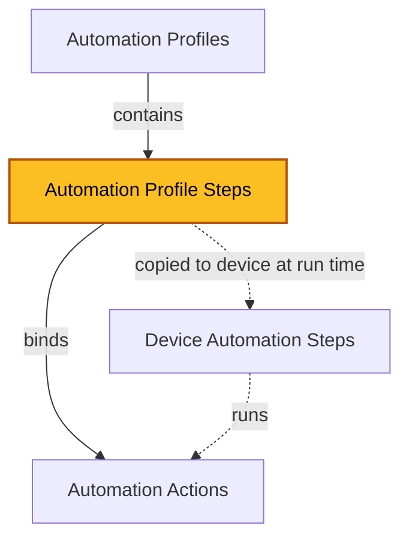

| [Home](../../README.md) / [Modules](../modules.md) |
|-----------------------------------------------------|

# Automation Profile Steps

Record module: `ztpf_automation_profile_steps`



*The highlighted box marks the module documented on this page.*

## Summary

Automation Profile Steps are the ordered steps inside an [Automation Profile](./automation_profiles.md). Each step binds a step number to an [Automation Action](./automation_actions.md) and provides Step ARGS — the YAML input and config values the action needs. Steps are design-time records; nothing executes from a profile step directly.

When a profile is applied to a device, each profile step is copied onto the device as a [Device Automation Step](./device_automation_steps.md), carrying the step name, the linked action, and the Step ARGS. The device step then renders the Step ARGS — including any Jinja inside them — with that device's data and executes through the normal step queue. Because rendering happens per device, one profile can serve any number of devices.

Steps run in Step Number order, and the `Move Step Number on Automation Profile` button keeps the numbering gapless when steps are reordered.

## Fields

| Field | Type | Required | How it is used |
| ----- | ---- | -------- | -------------- |
| Step Number | Integer | Yes | Position of the step within the profile. Steps execute in Step Number order. |
| Name | Text | No | Name of the step. Copied to the Device Automation Step when the profile is applied. |
| Automation Profile | Lookup (`ztpf_automation_profiles`) | No | The profile this step belongs to. |
| Automation Action | Lookup (`ztpf_automation_actions`) | No | The action this step performs. |
| Step ARGS | Text Area | No | YAML that provides the `input:` values and `config:` options for this step. See [Step ARGS](#step-args) below. |
| id, createDate, createUser, modifyDate, modifyUser | System | — | System-managed record details shown on the record's Details tab. |

## Step ARGS

Step ARGS is YAML with two sections. `input:` values are passed to the action's Jinja script as `input.<field>`, and `config:` options change how the step runs:

```yaml
input:
  firmware: 7.6.6
  diff_steps: 1,4
config:
  render_script_on_preparing: true
```

 * `input:` — the values this step supplies to the action. Which input fields are needed depends on what the Automation Action requires: each action declares the fields it expects in its Input Parameters, and the step provides a value for each. Values support Jinja and are rendered for each device.
 * `config:` — options that apply to any step, no matter which Automation Action is selected. These control how the framework runs the step:

| Config option | Values | Default | Description |
| ------------- | ------ | ------- | ----------- |
| render_script_on_preparing | true / false | false | Render the script payload during the Preparing phase instead of when the step runs. Useful to review the payload before execution. |
| render_script_on_running | true / false | false | Re-render the script payload when the step runs, even if it was already rendered while preparing. |
| sync_source_data_device | true / false | false | Synchronize the device Source Data from the Manager before the step runs. |
| wait_check_time | seconds | 60 | Interval between Wait Checks when a step is in a Wait status. |
| reporting_step | true / false | false | Mark the step as a reporting step so it is considered in reports. |

The `Configure stepARGs Help` button on a step lists these options and updates the Step ARGS field for you.

## Working with Profile Steps

 * `Add Step from Action` — on the Automation Profile, adds a new step bound to a selected Automation Action.
 * `Configure stepARGs Help` — prompts with the available config options and updates the step's Step ARGS field.
 * `Move Step Number on Automation Profile` — moves a step to a new position and re-sequences the remaining step numbers.
 * `Delete Automation Profile Step Record` — deletes one or more profile step records.

## Related Modules

 * [Automation Profiles](./automation_profiles.md) — the profile this step belongs to.
 * [Automation Actions](./automation_actions.md) — the action this step performs.
 * [Device Automation Steps](./device_automation_steps.md) — the runtime copies of these steps on a device.
 * [Run Groups](./run_groups.md) — created when the copied steps are queued for execution.

| [Modules](../modules.md) | [Automation Actions](./automation_actions.md) |
|--------------------------|------------------------------------------------|
