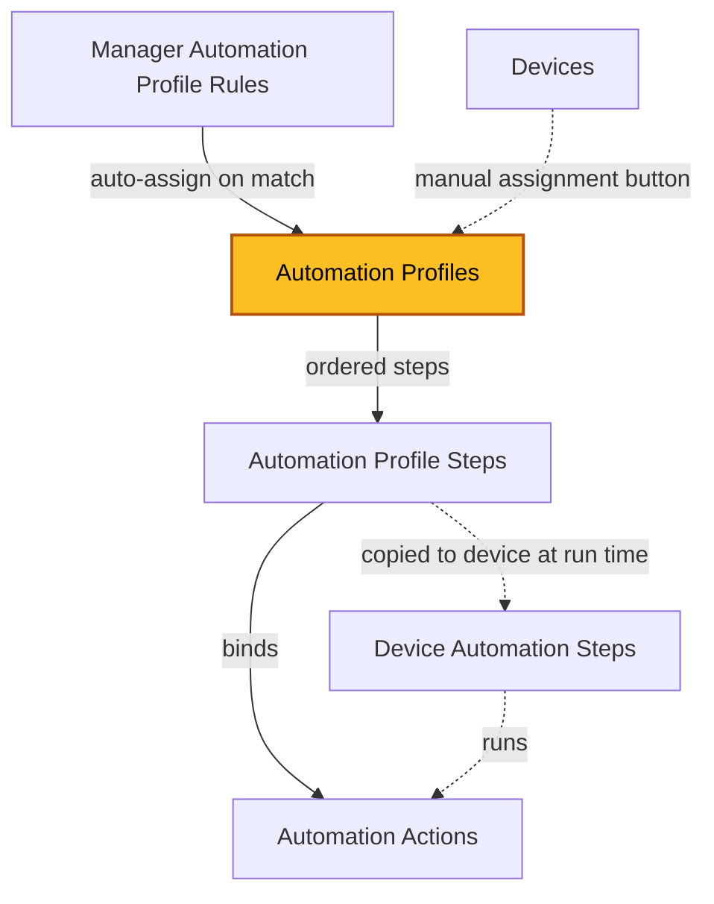

| [Home](../../README.md) / [Modules](../modules.md) |
|-----------------------------------------------------|

# Automation Profiles

Record module: `ztpf_automation_profiles`

*The highlighted box marks the module documented on this page.*

## Summary

An Automation Profile is a named, ordered automation recipe — such as onboarding a new device, a lifecycle change, or a firmware upgrade with pre/post checks. The profile itself only names and describes the solution; all of the work is defined by the [Automation Profile Steps](./automation_profile_steps.md) it contains, and each of those steps is bound to an [Automation Action](./automation_actions.md).

A profile is applied to a device in one of two ways:

 * **Manually** — from a Device record, the `Add Steps to Device from Profile` button prompts for a profile, copies its steps onto the device, and creates a [Run Group](./run_groups.md) to execute them.
 * **Automatically** — a [Manager Automation Profile Rules](./manager_automation_profile_rules.md) record watches devices on a Manager and assigns the profile when a device matches its search criteria.

When a profile is applied, its steps are not run directly. The runtime copy of each step is created as a [Device Automation Step](./device_automation_steps.md) on the device, which then executes through the normal step queue. This keeps the profile reusable across any number of devices.

## Fields

| Field | Type | Required | How it is used |
| ----- | ---- | -------- | -------------- |
| Name | Text | Yes | The profile name. Shown as the record title and used when selecting a profile for a device. |
| Description | Rich Text | No | Free-form description of what the profile accomplishes and any notes for other authors. |
| Automation Profile Steps | Related Records (`ztpf_automation_profile_steps`) | No | The ordered steps that belong to this profile. Each step binds a step number to an Automation Action and its Step ARGS. |
| Manager Automation Profile Rules | Related Records (`ztpf_manager_automation_profile_rules`) | No | Rules that reference this profile for automatic assignment to matching devices on a Manager. |
| id, createDate, createUser, modifyDate, modifyUser | System | — | System-managed record details shown on the record's Details tab. |

## Working with Profiles

 * `Add Step from Action` — adds a step to the profile that performs a selected Automation Action.
 * `Move Step Number on Automation Profile` — reorders steps; step numbers are re-sequenced without gaps.
 * `Delete Profile and Steps` — removes the profile and all of its steps.
 * `Manage Tags on Records` / `Export Records by Tag` — tag profiles to group, find, or export them as reusable solutions.

## Related Modules

 * [Automation Profile Steps](./automation_profile_steps.md) — the ordered steps in this profile.
 * [Automation Actions](./automation_actions.md) — what each step executes.
 * [Device Automation Steps](./device_automation_steps.md) — the runtime copies of profile steps on a device.
 * [Manager Automation Profile Rules](./manager_automation_profile_rules.md) — automatic assignment of this profile to devices.
 * [Run Groups](./run_groups.md) — created when profile steps are queued for execution.

| [Modules](../modules.md) | [Automation Profile Steps](./automation_profile_steps.md) |
|--------------------------|------------------------------------------------------------|
