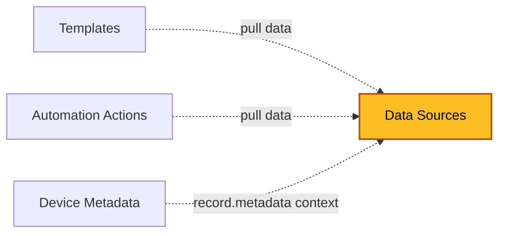

| [Home](../../README.md) / [Modules](../modules.md) |
|-----------------------------------------------------|

# Data Sources

Record module: `ztpf_metadata_sources` (shown as **Data Sources** in the UI)

*The highlighted box marks the module documented on this page.*

## Summary

Data Sources collect and shape runtime data used while rendering [Templates](./templates.md) and [Automation Actions](./automation_actions.md). Each source's script supports Jinja and produces YAML or JSON that describes how to generate its data; the results are merged into the Jinja context under the source's Data Key as `data.<datakey>`.

Sources run in Order Priority sequence — lowest first, highest last. If two sources use the same Data Key, their results merge and the higher-priority source overwrites values from the lower one. This makes it easy to layer, for example, a static default with live device data.

> **Data Sources are not Device Metadata.** [Device Metadata](./device_metadata.md) is a separate module that stores persistent key/value values on a device record. The two work together — a source's script can read a device's metadata as `record.metadata.<name>`, and action output can write Device Metadata records — but a Data Source itself is a runtime collector, not a storage record.

## Source Types

| Type | Description |
| ---- | ----------- |
| [Static Data](./data_sources/static_data.md) | The script renders to a static YAML or JSON value. |
| [FortiManager API](./data_sources/fortimanager_api.md) | The script renders a JSON-RPC table query — URL, fields, filter, and options — that is run against the Manager. |
| [FortiManager Proxy API](./data_sources/fortimanager_proxy_api.md) | The script renders a proxied REST request — action, target, resource, and payload — sent through the Manager to the device REST API. |
| [Playbook](./data_sources/playbook.md) | The script renders a playbook ID and arguments; the playbook's output becomes the data. |
| [Step Output](./data_sources/step_output.md) | Reads the output of an earlier step in the run. |
| [Spreadsheet Attachments](./data_sources/spreadsheet_attachments.md) | Reads data from a spreadsheet attachment. |

Each type is documented on its own page under `data_sources/`, with the script template the type expects and how the runner executes it.

## Fields

| Field | Type | Required | How it is used |
| ----- | ---- | -------- | -------------- |
| **Definition** | | | |
| Name | Text | No | Name of the source. |
| Description | Rich Text | No | What the source collects and why. |
| Type | Picklist | No | How the source collects its data. See [Source Types](#source-types) above. |
| Data Key | Text | Yes | The key the results are stored under at runtime as `data.<datakey>`. Duplicate keys merge; higher Order Priority wins. |
| Order Priority | Integer | No | Run order. Lower numbers run first; higher numbers run last and overwrite values from lower numbers. |
| **Script** | | | |
| Script | Text Area | No | Jinja script producing YAML or JSON that configures how the data is generated. The expected format depends on the Type. |
| Input Parameters | Text Area | No | Declares input fields usable in the script as `input.<fieldname>`. |
| **Examples** | | | |
| Example Jinja Vars | Object | No | The jinja_vars used to create the example output. |
| Example Output | Object | No | An example of the output created from the example vars. |
| **Usage** | | | |
| Templates | Many-to-many (`ztpf_templates`) | — | Templates that pull data from this source. |
| Automation Actions | Many-to-many (`ztpf_automation_actions`) | — | Actions that pull data from this source. |
| id, createDate, createUser, modifyDate, modifyUser | System | — | System-managed record details shown on the record's Details tab. |

## Working with Data Sources

 * `Configure Data` — helps build the script for the selected Type.
 * `Script Help` — helps build the script using existing linked records.
 * `Get Metadata for Device` — runs the source against a device and shows the data it would produce.
 * `Delete Example Data` — clears the example data fields on the record.

## Related Modules

 * [Templates](./templates.md) — pull `data.<datakey>` values from this source.
 * [Automation Actions](./automation_actions.md) — pull `data.<datakey>` values from this source.
 * [Device Metadata](./device_metadata.md) — a different module: persistent per-device values that a source can read as `record.metadata.<name>`.

| [Modules](../modules.md) | [Managers](./managers.md) |
|--------------------------|----------------------------|
