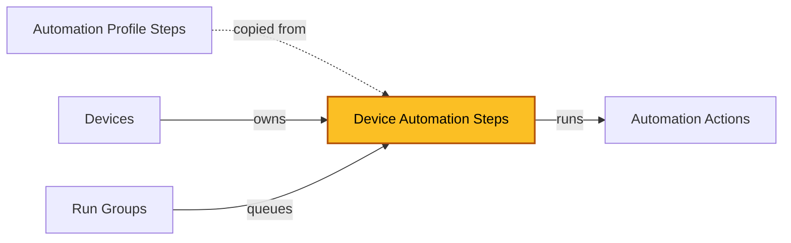

| [Home](../../README.md) / [Modules](../modules.md) |
|-----------------------------------------------------|

# Device Automation Steps

Record module: `ztpf_device_automation_steps`

*The highlighted box marks the module documented on this page.*

## Summary

Device Automation Steps are the runtime queue of ZTPF automation: one record per step per device, copied from [Automation Profile Steps](./automation_profile_steps.md) when a profile is applied to a [Device](./devices.md).

There is no master playbook that runs the queue top to bottom. Instead, each step's status transitions fire triggers, and the [Run Group](./run_groups.md) chains one step to the next. When a step reaches `Running`, its Trigger Key — the Category and Type of its [Automation Action](./automation_actions.md) — dispatches the playbook that performs the work.

At preparation the step's Step ARGS are rendered with the device's data: the input values become `input.*` in the action's Jinja script, the rendered script is stored on the step, and the Jinja vars used are kept in `jinjaVars` for review and re-rendering. After the action runs, the raw output is stored in Output Source Data and rendered by the action's output templates into the Output Text, Markdown, HTML, and JSON fields; the Output Status Template evaluates the result to set Output Status and, on completion, the step records its duration and chains to the next step.

## Status

The status field drives the whole framework. Each transition can fire a trigger:

| Status | Meaning |
| ------ | ------- |
| New | The step was created. |
| Preparing | Inputs are validated and Jinja is rendered. |
| Input Needed | Inputs are missing or invalid; a user must supply values on the record. |
| Ready | Validated and waiting to be queued. |
| Queued | Assigned to a Run Group. |
| Running | Currently executing; the Trigger Key dispatches the action playbook. |
| Waiting | The step is waiting on a condition before it can continue. |
| Waiting Check | A wait check is being evaluated. |
| Waiting Timer | The timer between wait checks is running. |
| Cancel | The step was cancelled. |
| Complete | Finished successfully. |
| Fail | Finished with an error. |
| Abort | The run was aborted. |

## Fields

| Field | Type | Required | How it is used |
| ----- | ---- | -------- | -------------- |
| **Queue** | | | |
| Device | Lookup (`ztpf_devices`) | Yes | The device this step runs on. |
| Run Group | Lookup (`ztpf_run_groups`) | No | The group that launched this step. |
| Step Number | Integer | Yes | Order of operation in the queue. Ties fall back to the step name. |
| Name | Text | No | Name of the automation step performed on the device. |
| Status | Picklist | No | Drives the queue. See [Status](#status) above. |
| Automation Action | Lookup (`ztpf_automation_actions`) | No | The action this step executes. |
| Trigger Key | Text | No | Populated from the action's Category and Type; used to trigger the action playbook. |
| Step ARGS | Text Area | No | YAML `input:` and `config:` values for this step, rendered per device. |
| Jinja Vars | Object | No | The jinja_vars used to render the script for this step. |
| Script | Text Area | No | The rendered script used by this automation step. |
| **Timing** | | | |
| Start Timestamp | Datetime | No | When the step started running. |
| Stop Timestamp | Datetime | No | When the step stopped running. |
| Step Done | Checkbox | No | Terminal flag — once set, nothing further should be done with the step. |
| Step Time Seconds | Integer | No | Execution time in seconds, from start and stop times. |
| Step Time | Text | No | Human-readable execution time. |
| **Output** | | | |
| Output Source Data | Object | No | Raw output from the action, used to build the step output and readable by later steps such as diffs. |
| Output Type | Picklist | No | The output format expected from the action. |
| Output Text | Text Area | No | Rendered text output. |
| Output Markdown | Rich Text | No | Rendered markdown output. |
| Output HTML | HTML | No | Rendered HTML output. |
| Output JSON | Object | No | Rendered JSON output. |
| Output Status | Picklist | No | OK, Exceptions Found, or Incomplete — set by evaluating the action's Output Status Template. |
| Output Status Message | Rich Text | No | Message produced by the output status evaluation. |
| **Waiting** | | | |
| Step Waiting | Checkbox | No | True while the step is waiting for a wait check to return. |
| Wait to Check Seconds | Integer | No | How long to wait between wait checks. |
| **Reporting** | | | |
| Reporting Step | Checkbox | No | Marks the step as a reporting step, considered when building reports. |
| id, createDate, createUser, modifyDate, modifyUser | System | — | System-managed record details shown on the record's Details tab. |

## Working with Device Steps

 * `Prepare Step Payload` — re-runs preparation for the step, rendering Step ARGS and the script.
 * `Configure stepARGs Help` — prompts with the available config options and updates the Step ARGS field.
 * `Configure stepARGs All via YAML` — edits the Step ARGS of multiple steps through one YAML editor.
 * `Move Step Number` — moves the step to a new position in the queue.
 * `ReRun Running Step` — re-runs a step that is stuck in Running.
 * `Re-Render Output on Completed Step` — regenerates the output fields of a completed step.
 * `Delete Step Payload` — clears the rendered payload from the step.

## Related Modules

 * [Devices](./devices.md) — own these steps and provide the data they render with.
 * [Run Groups](./run_groups.md) — queue and chain these steps.
 * [Automation Actions](./automation_actions.md) — define the work each step performs.
 * [Automation Profile Steps](./automation_profile_steps.md) — the design-time steps copied into these records.

| [Modules](../modules.md) |
|--------------------------|
