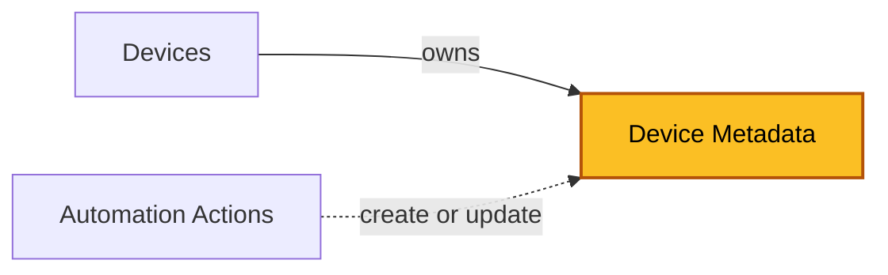

| [Home](../../README.md) / [Modules](../modules.md) |
|-----------------------------------------------------|

# Device Metadata

Record module: `ztpf_metadata_devices`

*The highlighted box marks the module documented on this page.*

## Summary

Device Metadata records are a per-device key/value store. Each record holds one value for one device, typed as Text, Secret, or JSON. The values a device accumulates are aggregated into the device record's `Metadata` field and exposed to Jinja as `record.metadata.<name>`, where they can be used by [Templates](./templates.md), [Automation Actions](./automation_actions.md), and [Data Sources](./data_sources.md).

Metadata values can be synchronized to FortiManager variables, so data maintained in FortiSOAR can be consumed by existing FortiManager solutions with minimal effort.

Values can be flagged as `Input Needed`, which prompts users to supply required data before deployment. Automation Actions can create or update metadata records from step output through their Output to Metadata Record Template.

> **Device Metadata is not Data Sources.** [Data Sources](./data_sources.md) are runtime collectors that fetch data while rendering; Device Metadata records are the persistent values stored with the device.

## Fields

| Field | Type | Required | How it is used |
| ----- | ---- | -------- | -------------- |
| Device | Lookup (`ztpf_devices`) | No | The device this metadata belongs to. |
| Name | Text | No | The metadata key. Exposed to Jinja as `record.metadata.<name>`. |
| Type | Picklist | Yes | Text, Secret, or JSON — selects which data field holds the value. |
| Data Text | Text | No | The value when Type is Text. |
| Data JSON | Object | No | The value when Type is JSON. |
| Data Secret | Text (encrypted) | No | The value when Type is Secret. Encrypted and cannot be seen once updated. |
| Status | Picklist | No | New, Ok, Input Needed, or Disable. `Input Needed` flags values a user must supply. |
| id, createDate, createUser, modifyDate, modifyUser | System | — | System-managed record details shown on the record's Details tab. |

## Related Modules

 * [Devices](./devices.md) — owns these records and aggregates them into its Metadata field.
 * [Automation Actions](./automation_actions.md) — can create or update these records from step output.
 * [Data Sources](./data_sources.md) — a different module: runtime collectors that can read these values as `record.metadata.<name>`.

| [Modules](../modules.md) | [Run Groups](./run_groups.md) |
|--------------------------|--------------------------------|
