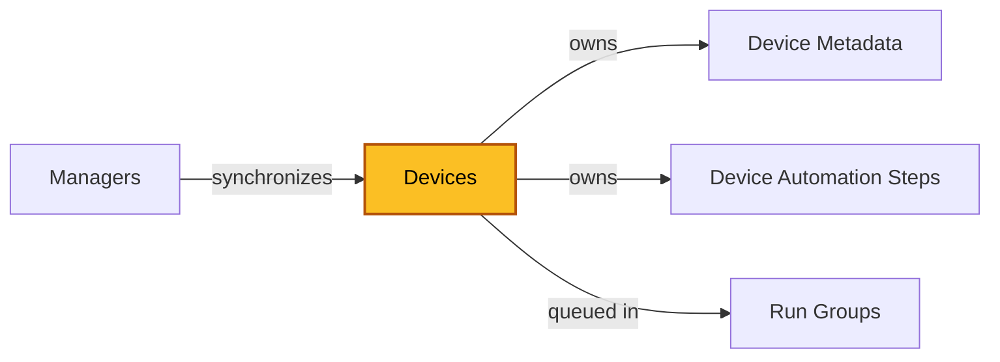
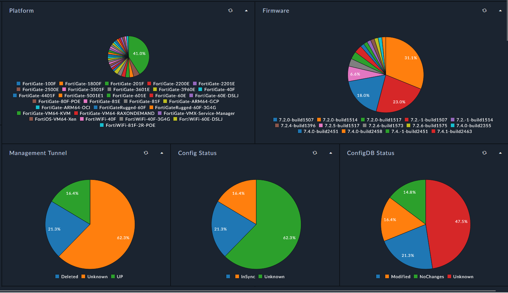
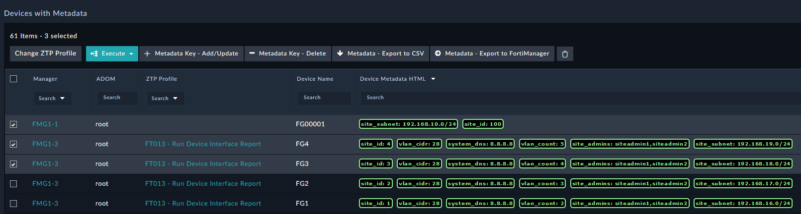
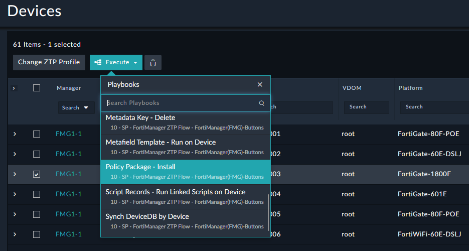

| [Home](../../README.md) / [Modules](../modules.md) |
|-----------------------------------------------------|

# Devices

Record module: `ztpf_devices`

*The highlighted box marks the module documented on this page.*

## Summary

Device records are created by synchronizing a Manager's Device DB and are the target of all ZTPF automation. The device's identity and state — ADOM, VDOM, management mode and IP, connection status, platform, firmware, config status, assigned provisioning templates, and policy package — are populated from Source Data collected from the Manager.

When a device is removed from, or moved to another Manager, the record is retained with its last known state so reporting and automation history remain available.

The `Metadata` field aggregates the device's per-device values for use in Jinja scripts and can be synchronized to FortiManager variables. It is maintained by [Device Metadata](./device_metadata.md) records and playbook automation and should not be edited directly, as the flow of data can be impacted.

While automation is running, `ztpfRunning` marks the device as active and `ztpfArtifacts` holds runtime data for the current run.

## Fields

| Field | Type | Required | How it is used |
| ----- | ---- | -------- | -------------- |
| **Identity** | | | |
| Name | Text | Yes | Name of the device. |
| Serial | Text | No | From Source Data. |
| Description | Rich Text | No | Notes about this device. |
| Manager | Lookup (`ztpf_managers`) | No | The Manager this device belongs to. |
| **State** | | | |
| Admin Status | Picklist | Yes | Enabled or Disabled. Disabled devices are ignored by all actions. |
| Status | Picklist | Yes | The status of the ZTPF element, changed by triggers and actions in the system. |
| **From Source Data** | | | |
| Source Data | Object | No | Raw data collected from the Manager's API about this device. |
| ADOM | Text | No | From Source Data. |
| VDOM | Text | No | From Source Data. |
| Management Mode | Text | No | From Source Data. |
| Management IP | Text | No | From Source Data. |
| Connection Status | Text | No | From Source Data. |
| Platform | Text | No | From Source Data. |
| Product Family | Text | No | Derived from the Platform field. |
| Firmware | Text | No | From Source Data. |
| Config Status | Text | No | From Source Data. |
| ConfigDB Status | Text | No | From Source Data. |
| Provisioning Templates | Text | No | Device templates assigned to the FortiGate in the Manager. |
| Policy Package | Text | No | Policy package assigned to the FortiGate in the Manager. |
| **Metadata** | | | |
| Metadata | Object | No | Aggregated per-device values used in Jinja and synchronized to FortiManager variables. Maintained by Device Metadata records and playbooks — not edited directly. |
| Metadata Records | Related Records (`ztpf_metadata_devices`) | — | The individual key/value records behind the Metadata field. |
| **Runtime** | | | |
| ztpfRunning | Checkbox | No | True while ZTPF is actively running steps in the queue for this device. |
| ztpfArtifacts | Object | No | ZTPF data while running on this device. |
| **Related Records** | | | |
| Automation Steps | Related Records (`ztpf_device_automation_steps`) | — | The runtime steps for this device. |
| Run Groups | Related Records (`ztpf_run_groups`) | — | Run groups this device has been queued into. |
| Comments | Related Records | — | Record comments. |
| id, createDate, createUser, modifyDate, modifyUser | System | — | System-managed record details shown on the record's Details tab. |

## Working with Devices

Devices expose different actions depending on the dashboard or view, such as the Device Metadata Manager.

 * `Add Steps from Profile` — prompts for an Automation Profile and copies its steps onto the device.
 * `Add Action` — adds a single action as a device step.
 * `Create Run Group and Queue Steps` — queues the device's pending steps into a new [Run Group](./run_groups.md) and starts execution.
 * `Synch DVMDB Data` — refreshes the device's Source Data and related fields from the Manager.

## Related Modules

 * [Managers](./managers.md) — the Manager this device was synchronized from.
 * [Device Metadata](./device_metadata.md) — per-device values exposed to Jinja as `record.metadata.<name>`.
 * [Device Automation Steps](./device_automation_steps.md) — the runtime steps that execute on this device.
 * [Run Groups](./run_groups.md) — batches this device's steps into a single execution.

| [Modules](../modules.md) | [Device Metadata](./device_metadata.md) |
|--------------------------|------------------------------------------|
