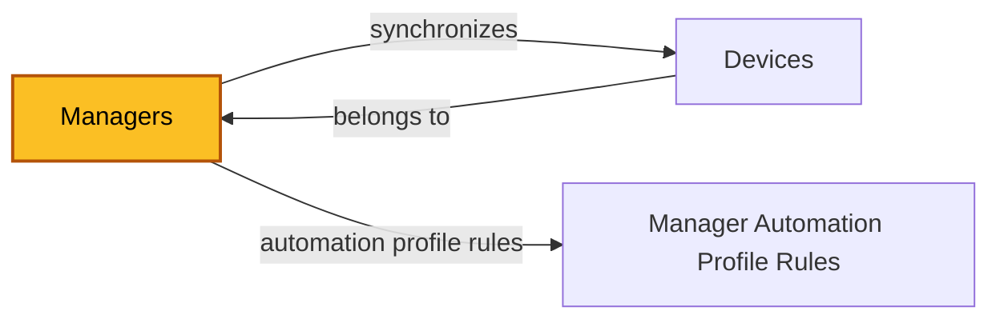
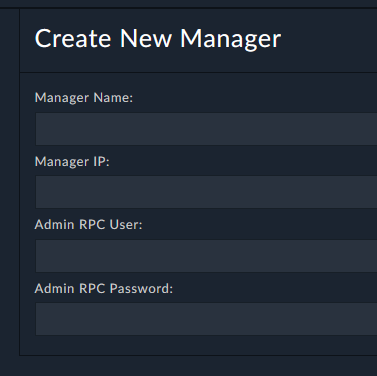
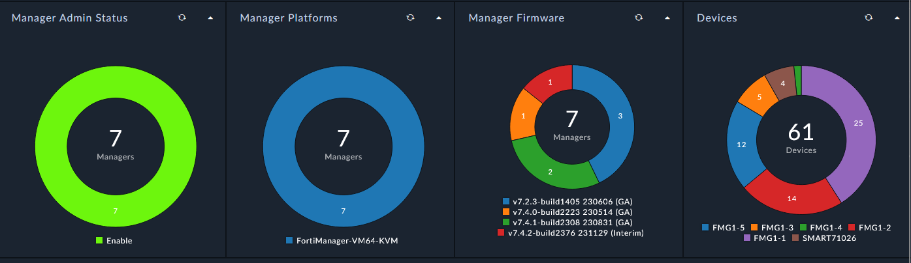
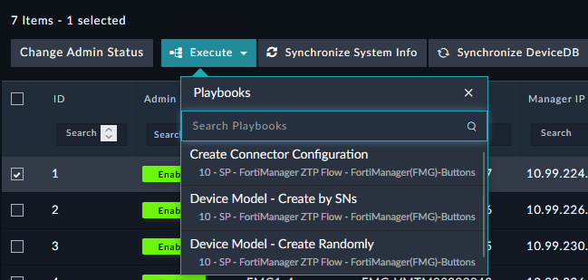

| [Home](../../README.md) / [Modules](../modules.md) |
|-----------------------------------------------------|

# Managers

Record module: `ztpf_managers`

*The highlighted box marks the module documented on this page.*

## Creating a Manager

Creating a Manager record requires minimal information: a `Manager IP/Domain`, an `Admin RPC User`, and an `Admin RPC Password`. The `Manager Port` defaults to 443.

## Summary

Once created, the Manager record connects to the FortiManager and stores what it finds for automation and reporting. Creating the record automatically creates the FortiManager JSON-RPC connector configuration named on the record, so every later API call runs through that connector.

The `Synchronize System Info` action populates the discovery fields — Platform, Firmware, Serial Number, License Status, Time Zone, ADOM Mode, Max ADOMs, and Max Devices — and stores the raw API response in Source Data.

The `Get New Device` settings control how new devices are discovered when the Device DB is synchronized: all devices, unauthorized devices only, or a custom JSON-RPC filter.

## Fields

| Field | Type | Required | How it is used |
| ----- | ---- | -------- | -------------- |
| **Connection** | | | |
| Name | Text | Yes | Name of the Manager. |
| Description | Rich Text | No | Notes about this Manager. |
| Manager IP/Domain | Text | No | FortiManager IP or hostname to connect to via the Manager Port. |
| Manager Port | Integer | No | Admin TCP port. Defaults to 443. |
| Admin RPC User | Text | No | FortiManager admin account with JSON-RPC enabled. |
| Admin RPC Password | Text | No | Password for the Admin RPC User. |
| Connector Config | Text | No | Name of the FortiManager JSON-RPC connector configuration created for this record. |
| **State** | | | |
| Admin Status | Picklist | Yes | Enabled or Disabled. Disabled ignores the Manager and all of its related devices. |
| Status | Picklist | Yes | The status of the ZTPF element, changed by triggers and actions. |
| **Discovered from the API** | | | |
| Source Data | Object | No | Raw system information collected from the FortiManager API. |
| Platform | Text | No | From Source Data. |
| Firmware | Text | No | From Source Data. |
| Serial Number | Text | No | From Source Data. |
| License Status | Text | No | From Source Data. |
| Time Zone | Text | No | From Source Data. |
| ADOM Mode | Text | No | From Source Data. |
| Max ADOMs | Integer | No | From Source Data. |
| Max Devices | Integer | No | From Source Data. |
| **Device Discovery** | | | |
| Get New Device Type | Picklist | Yes | All, Unauthorized, or Custom Filter — which devices are pulled when the Device DB is synchronized. |
| Get New Device Filter | Object | No | JSON-RPC filter used when Get New Device Type is Custom Filter. Example: `["name","like","FG%"]`. |
| **Related Records** | | | |
| Devices | Related Records (`ztpf_devices`) | — | The device records synchronized from this Manager. |
| Automation Profile Rules | Related Records (`ztpf_manager_automation_profile_rules`) | — | Rules that auto-assign Automation Profiles to this Manager's devices. |
| Comments | Related Records | — | Record comments. |
| id, createDate, createUser, modifyDate, modifyUser | System | — | System-managed record details shown on the record's Details tab. |

## Working with Managers

 * `Create/Update Connector Configuration` — creates or updates the FortiManager JSON-RPC connector configuration for this record.
 * `Synchronize System Info` — refreshes the system information fields from the API.
 * `Synch Devices (New)` — synchronizes the Device DB and creates new device records per the Get New Device settings.
 * `Purge Device Records` — removes device records belonging to this Manager.

## Related Modules

 * [Devices](./devices.md) — synchronized from this Manager's Device DB.
 * [Manager Automation Profile Rules](./manager_automation_profile_rules.md) — auto-assign Automation Profiles to this Manager's devices.

| [Modules](../modules.md) | [Devices](./devices.md) |
|--------------------------|--------------------------|
