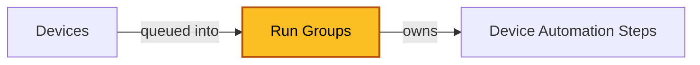

| [Home](../../README.md) / [Modules](../modules.md) |
|-----------------------------------------------------|

# Run Groups

Record module: `ztpf_run_groups`

*The highlighted box marks the module documented on this page.*

## Summary

A Run Group batches the pending [Device Automation Steps](./device_automation_steps.md) of one or more [Devices](./devices.md) into a single named execution. Run groups are created automatically when steps are queued — for example by the `Create Run Group and Queue Steps` action on a device — and the group name is generated at run time.

The group tracks the size and progress of the run: total steps, total devices, steps complete, and the total running time calculated from the first step start to the last step stop. While steps are still executing, `ztpfRunning` is true on the group and on each involved device.

When the queue drains, the group moves to `Reviewing`, which evaluates the steps: if none are pending, the group completes and the running flags clear on the devices; otherwise the run continues.

## Status

| Status | Meaning |
| ------ | ------- |
| New | The group was created. |
| Running | Steps are executing. |
| Reviewing | The queue drained; steps are being evaluated. |
| Complete | All steps in the group finished. |
| Fail Detected | A failed step was detected in the group. |
| Abort Detected | An aborted step was detected in the group. |

## Fields

| Field | Type | Required | How it is used |
| ----- | ---- | -------- | -------------- |
| Name | Text | No | Name of the run group, auto-generated at run time. |
| Status | Picklist | No | The group status. See [Status](#status) above. |
| ztpfRunning | Checkbox | No | True while steps are still running in this group. |
| Devices | Many-to-many (`ztpf_devices`) | No | The devices included in this run. |
| Device Automation Steps | One-to-many (`ztpf_device_automation_steps`) | No | The steps queued by this group. |
| Total Steps | Integer | No | Count of steps in this group. |
| Total Devices | Integer | No | Count of devices in this group. |
| Total Steps Complete | Integer | No | Count of steps in this group that are complete. |
| Total Running Time Seconds | Integer | No | Delta between the first step start time and the last step stop time. |
| Total Running Time | Text | No | Human-readable version of the total running time. |
| id, createDate, createUser, modifyDate, modifyUser | System | — | System-managed record details shown on the record's Details tab. |

## Related Modules

 * [Devices](./devices.md) — queued into the run group.
 * [Device Automation Steps](./device_automation_steps.md) — the steps executed by the group.
 * [Automation Profile Steps](./automation_profile_steps.md) — the design-time steps copied into the run.

| [Modules](../modules.md) | [Device Automation Steps](./device_automation_steps.md) |
|--------------------------|----------------------------------------------------------|
