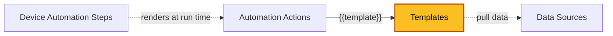

| [Home](../../README.md) / [Modules](../modules.md) |
|-----------------------------------------------------|

# Templates

Record module: `ztpf_templates`

*The highlighted box marks the module documented on this page.*

## Summary

Templates are reusable Jinja scripts that produce a payload in a declared Output Type — Text, JSON, Markdown, or HTML. When linked to an [Automation Action](./automation_actions.md), the rendered template becomes the `{{template}}` variable inside the action's script; a common pattern is an action whose script is only `{{template}}`, with all of the payload authored in the template.

A template is rendered with the full Jinja context for the device: device and manager data (`record.device.*`, `record.manager.*`, `record.metadata.*`), the step's inputs (`input.*`), and the results of any linked [Data Sources](./data_sources.md) (`data.<datakey>`). Because the rendering happens per device at run time, one template can serve any number of devices.

Templates declare their own Input Parameters, so a step can supply values the same way it does for actions. The example fields let authors render and review the output before putting the template into service, and a template can be reused by many actions.

## Fields

| Field | Type | Required | How it is used |
| ----- | ---- | -------- | -------------- |
| **Definition** | | | |
| Name | Text | Yes | Name of the template. |
| Description | Rich Text | No | What the template produces and any notes for other authors. |
| Output Type | Picklist | Yes | The format the script must produce: Text, Markdown, HTML, or JSON. |
| Script | Text Area | No | The Jinja script. Rendered with `record.*`, `input.*`, and `data.*` context and expected to produce the declared Output Type. |
| Input Parameters | Text Area | No | Declares the input fields a step can provide. Usable in the script as `input.<fieldname>`. |
| Metadata Sources | Many-to-many (`ztpf_metadata_sources`) | No | Linked Data Sources that supply `data.<datakey>` values while rendering this template. |
| **Examples** | | | |
| Example Jinja Vars | Object | No | Sample jinja_vars used to produce the example output. |
| Example Output Text | Text Area | No | Example output when the Output Type is Text. |
| Example Output JSON | Object | No | Example output when the Output Type is JSON. |
| Example Output Text Markdown | Rich Text | No | Example output when the Output Type is Markdown. |
| Example Output Text HTML | HTML | No | Example output when the Output Type is HTML. |
| **Usage** | | | |
| Automation Actions | Related Records (`ztpf_automation_actions`) | — | Actions that link this template. |
| id, createDate, createUser, modifyDate, modifyUser | System | — | System-managed record details shown on the record's Details tab. |

## Working with Templates

 * `Script Help` — helps build the template script using its linked Data Sources.
 * `Render Jinja Script` — renders the template so the output can be reviewed.
 * `Delete Example Data` — clears the example data fields on the record.

## Related Modules

 * [Automation Actions](./automation_actions.md) — link this template and render it as `{{template}}`.
 * [Data Sources](./data_sources.md) — supply `data.<datakey>` values for the render.
 * [Device Automation Steps](./device_automation_steps.md) — trigger the run-time rendering per device.
 * [Automation Profile Steps](./automation_profile_steps.md) — provide the `input.*` values through Step ARGS.

| [Modules](../modules.md) | [Data Sources](./data_sources.md) |
|--------------------------|------------------------------------|
